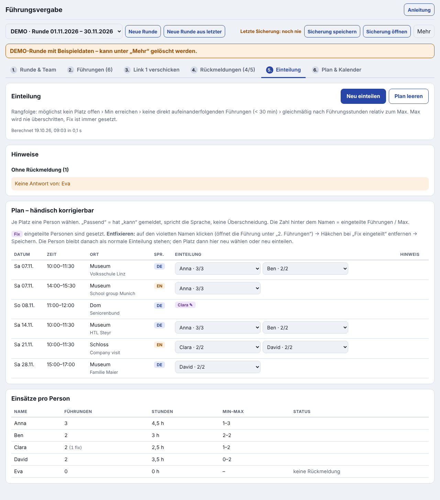
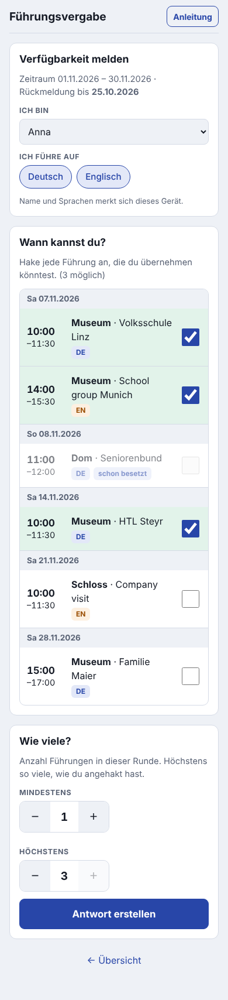
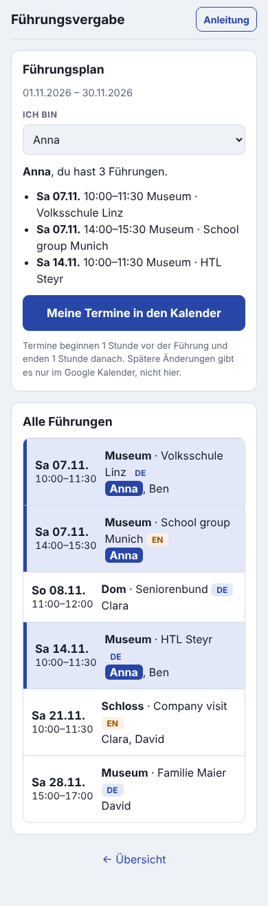

# Führungsvergabe

Eine kleine App, mit der ein Team Führungen fair verteilt: Wer kann wann, wie viele möchte jede Person machen, und am Ende gibt es einen Plan und Kalendertermine.

- **Kein Server, keine Anmeldung, keine Cloud.** Die Daten bleiben auf den Geräten. Weitergegeben werden sie nur als WhatsApp-Nachricht oder als Datei, und zwar von den Personen selbst.
- **Funktioniert offline**, nachdem die App einmal geöffnet wurde: am Handy (iPhone und Android) und am PC.
- **Nichts installieren nötig.** Sie läuft im Browser; am Handy kann man sie zusätzlich auf den Homescreen legen.

**App öffnen: <https://creo08.github.io/fuehrungsvergabe/>**

- Kurzanleitung für die Bedienung (ohne Technik): [`app/ANLEITUNG.md`](app/ANLEITUNG.md), in der App über **Anleitung** oben rechts
- Fragen, Fehler, Wünsche: [Feedback geben](https://github.com/creo08/fuehrungsvergabe/issues/new?template=feedback.yml) (öffentlich, bitte keine Namen aus dem Team)
- Version und Änderungen: [`CHANGELOG.md`](CHANGELOG.md)
- Fachliche Prüfung, Messungen und alle Entscheidungen: [`PRUEFUNG.md`](PRUEFUNG.md)

| Koordination am Laptop | Rückmeldung am Handy | Plan am Handy |
|---|---|---|
|  |  |  |

Alle Bilder zeigen die eingebaute Demo-Runde mit erfundenen Daten.

---

## So läuft eine Runde ab

Eine Runde deckt einen Zeitraum ab, z. B. einen Monat oder sechs Wochen. Eine Person ist **Koordinator:in** und arbeitet am Laptop. Alle anderen nutzen ihr **Handy**.

### 1. Koordinator:in – Runde anlegen

1. App am Laptop öffnen → **Ich bin Koordinator:in** → **Neue Runde anlegen**. Ab der zweiten Runde geht es schneller mit **Neue Runde aus letzter**: Team und Sprachen werden übernommen.
2. Unter **1. Runde & Team**: Zeitraum, Rückmeldefrist und die Namen des Teams eintragen.
3. Unter **2. Führungen**: Führungen eintragen, entweder einzeln (**+ Führung**) oder aus Excel:
   - **Excel-Datei laden** (`.xlsx`) **oder**
   - in Excel die Zellen *inklusive Überschriftenzeile* markieren, kopieren, **Aus Excel einfügen** und einfügen.

   Vor dem Übernehmen zeigt die App eine Vorschau. Zeilen mit Problemen (z. B. unlesbares Datum, Ende vor Beginn, unbekannte Sprache, Fix-Name nicht im Team) sind rot markiert und werden **nicht** übernommen. Die App korrigiert nichts selbst.
4. Unter **3. Link 1 verschicken**: **Nachricht kopieren** und in die WhatsApp-Gruppe einfügen. Mit dem Schalter „Langtext mitschicken“ kommen auch die langen Beschreibungen mit.

### 2. Jede Person: Verfügbarkeit melden

1. Den Link in WhatsApp antippen. Klappt das nicht: Nachricht lange drücken → **Kopieren** → App öffnen → einfügen → **Öffnen**.
2. Namen wählen und Sprachen antippen. Beides merkt sich das Gerät.
3. Jede Führung anhaken, die man übernehmen *könnte*.
4. **Mindestens** und **Höchstens** wählen (Anzahl Führungen in dieser Runde). Höchstens geht nur bis zur Zahl der angehakten Führungen.
5. **Antwort erstellen** → **Nachricht kopieren** → per WhatsApp an den:die Koordinator:in schicken. Wer später etwas ändert, schickt einfach eine neue Antwort; die neueste gilt.

### 3. Koordinator:in – Antworten sammeln und einteilen

1. Unter **4. Rückmeldungen** gibt es zwei Wege:
   - Den Antwort-Link in **WhatsApp Web** bzw. WhatsApp am Laptop anklicken. Öffnet er sich im selben Browser wie die App, wird die Antwort automatisch übernommen.
   - Oder die Nachrichten kopieren und unter „Rückmeldungen einfügen“ einfügen, auch mehrere auf einmal.
2. Unter **5. Einteilung** → **Einteilen**. Die App rechnet einen fairen Plan aus:
   - Wer nicht kann oder die Sprache nicht spricht, wird nie eingeteilt.
   - Keine Überschneidungen.
   - Fix eingeteilte Personen bleiben gesetzt.
   - **Höchstens** wird nie überschritten.
   - Sonst gilt diese Reihenfolge: möglichst kein Platz offen → Mindestens erreichen → keine Führungen direkt hintereinander (weniger als 30 min Abstand) → gleichmäßig verteilt nach Führungsstunden im Verhältnis zum „Höchstens“ jeder Person.
3. Die Hinweise zeigen offene Plätze. Dort steht auch, wer einspringen könnte, auch wer dafür sein „Höchstens“ überschreiten müsste. Außerdem: wer unter „Mindestens“ liegt und wer nicht geantwortet hat.
4. Jeder Platz lässt sich **händisch ändern**. Passende Personen stehen oben, alle anderen mit Warnung darunter.

### 4. Plan verschicken und in den Kalender

1. Unter **6. Plan & Kalender** → **Nachricht kopieren** → in die WhatsApp-Gruppe (Link 3).
2. **Gesamtkalender herunterladen** und am Computer in Google Kalender importieren: calendar.google.com → Zahnrad → Einstellungen → *Importieren & Exportieren*.
   - Titel wie bisher, z. B. `Museum Hans, Peter`. Namen alphabetisch, `??` steht für einen offenen Platz.
   - **Nur einmal importieren.** Spätere Änderungen direkt im Google Kalender, nicht in der App.
3. Jede Person öffnet Link 3, sieht ihre Führungen hervorgehoben und holt sie mit **Meine Termine in den Kalender** in den eigenen Kalender:
   - Termin von 1 Stunde vorher bis 1 Stunde nachher.
   - Titel z. B. `Museum Führung 1000`, in der Beschreibung alle Eingeteilten.

### Sicherung und Koordinationswechsel

- Alles wird automatisch im Browser gespeichert.
- **Sicherung speichern** erzeugt eine Datei mit dem kompletten Stand. **Sicherung öffnen** liest sie auf einem anderen Gerät wieder ein. So funktionieren Gerätewechsel und die Übergabe an eine:n neue:n Koordinator:in.
- Oben steht „Letzte Sicherung: vor X Tagen“. Bitte regelmäßig sichern: Browser können lokale Daten löschen, Safari z. B. nach 7 Tagen ohne Besuch der Seite.

### Demo

Unter **Mehr → Demo-Runde anlegen** gibt es eine deutlich als **DEMO** markierte Beispielrunde mit 6 Führungen und 5 Personen. Sie wird nur auf Knopfdruck angelegt und lässt sich unter **Mehr → Diese Runde löschen** wieder entfernen.

---

## Excel-Vorlage

[`app/vorlage-fuehrungen.xlsx`](app/vorlage-fuehrungen.xlsx) gibt es auch in der App unter **2. Führungen → Vorlage herunterladen**. Eine Zeile pro Führung, die erste Zeile enthält die Überschriften. Die Spalten werden am Namen erkannt; Reihenfolge und Groß-/Kleinschreibung sind egal, weitere Spalten werden ignoriert.

| Spalte | Inhalt | Pflicht | Wenn leer |
|---|---|---|---|
| Ort | z. B. „Museum“ | ja | – |
| Datum | Excel-Datum oder `TT.MM.JJJJ` | ja | – |
| Beginn | `hh:mm` oder Excel-Zeit | ja | – |
| Ende | `hh:mm` oder Excel-Zeit, nach dem Beginn | ja | – |
| Sprache | `DE` / `EN` (Auswahlliste) | nein | DE |
| Personen | Gesamtzahl **inklusive** Fix | nein | 1 |
| Fix | Namen, mit Komma getrennt | nein | niemand |
| Kurztitel | eine Zeile, z. B. „Volksschule Linz“ | nein | leer |
| Beschreibung | Langtext, mehrzeilig (Alt+Enter) | nein | leer |

Die zwei gelben Beispielzeilen sind mit „BEISPIEL“ markiert. Beim Import erscheinen sie als Problemzeilen, damit sie nicht versehentlich übernommen werden.

---

## Einrichtung

### GitHub Pages aktivieren (einmalig)

1. Diesen Stand in den Branch `main` übernehmen (Pull Request mergen).
2. Auf GitHub im Repository: **Settings → Pages → Build and deployment → Source: „GitHub Actions“** wählen.
3. Fertig. Bei jedem Push auf `main` laufen die Tests, danach wird der Ordner `app/` veröffentlicht. Den Fortschritt zeigt der Tab **Actions**.
4. Die Adresse lautet `https://<github-name>.github.io/fuehrungsvergabe/` und steht auch unter Settings → Pages.

Geräte, die die App schon kennen, zeigen nach einer neuen Version oben „Neue Version verfügbar – Neu laden“.

### App auf den Homescreen legen (optional)

- **iPhone (Safari):** Adresse öffnen → Teilen-Symbol □↑ → **Zum Home-Bildschirm** → Hinzufügen.
- **Android (Chrome):** Adresse öffnen → Menü ⋮ → **App installieren** bzw. **Zum Startbildschirm hinzufügen**.
- **PC (Chrome/Edge):** Symbol „App installieren“ rechts in der Adressleiste. Das ist optional; ein normaler Tab reicht.

**Wichtig für das iPhone:**
- Links aus WhatsApp öffnen sich dort immer in **Safari**, nicht in der Homescreen-App. Beide haben getrennte Speicher.
- **Personen** am iPhone nutzen deshalb am besten einfach Safari, ohne Homescreen.
- Wer als **Koordinator:in** am iPhone arbeitet, nutzt die Homescreen-App, weil Safari Daten nach 7 Tagen ohne Besuch löschen kann. Antworten kommen dort über „Rückmeldungen einfügen“ hinein. Empfohlen bleibt der Laptop.

---

## Datenschutz

- Die Daten stehen im Link **nach dem `#`**. Dieser Teil wird vom Browser nie an den Webserver geschickt (RFC 3986). Die App entfernt ihn nach dem Öffnen außerdem aus der Adresszeile.
- Link 1 enthält Namen und Sprachen des Teams sowie die Führungen. Den Langtext enthält er nur, wenn der Schalter an ist.
- Min/Max einer Person stehen nur in ihrer eigenen Antwort an den:die Koordinator:in.
- Was in WhatsApp verschickt wird, liegt bei WhatsApp (Ende-zu-Ende-verschlüsselt). Beschreibungen mit Telefonnummern reisen entsprechend mit.
- Alle GitHub-Pages-Projekte desselben GitHub-Kontos teilen sich die Adresse `<name>.github.io`. Die App verwendet eigene Speichernamen.

---

## Entwicklung

Es gibt keinen Build-Schritt: reine ES-Module, alle Bibliotheken liegen in `app/vendor/` (Lizenzen in [`app/vendor/LIZENZEN.md`](app/vendor/LIZENZEN.md)).

```
app/                 die veröffentlichte App
  index.html, sw.js, manifest.webmanifest, css/, icons/
  ANLEITUNG.md       Kurzanleitung, in der App als Dialog (offline vorgehalten)
  js/model.js        Datenmodell, Zeiten (Wiener Wanduhrzeit als Text), Revisionen
  js/codec.js        Links: R (Runde), A (Antwort), P (Plan) + lz-string
  js/excel.js        .xlsx-Leser (fflate) und Einfüge-Parser, Zeilenprüfung
  js/solver.js       ILP-Modell + HiGHS, Auswertung/Hinweise
  js/ical.js         .ics nach RFC 5545 mit VTIMEZONE Europe/Vienna
  js/store.js        IndexedDB/localStorage, Sicherung
  js/markdown.js     kleiner Markdown-Renderer für die Anleitung
  js/ui-*.js         Oberfläche Koordinator:in/Person
  vendor/            highs (WebAssembly), fflate, lz-string
  vorlage-fuehrungen.xlsx
tests/               Unit-Tests (node --test) und Abnahmetest (Playwright)
tools/               Vorlage und Icons erzeugen, lokaler Server, Bildschirmfotos
docs/                Bildschirmfotos für dieses README
```

```sh
npm test                       # Unit-Tests: Excel/Einfügen, Solver (inkl. unlösbarer Fälle), Links, iCal, Sicherung
npm install && npm run test:e2e  # Abnahme im Browser (braucht Chromium; npx playwright install chromium)
npm start                      # lokal: http://localhost:8080/fuehrungsvergabe/
node tools/screenshots.mjs     # Bildschirmfotos für dieses README neu erzeugen (docs/)
python3 tools/make-vorlage.py  # Excel-Vorlage neu erzeugen (openpyxl)
python3 tools/make-icons.py    # Symbole neu erzeugen (Pillow)
```

Der Abnahmetest spielt eine Runde mit 6 Führungen und 5 Personen durch: Fix, beide Sprachen, eine Person ohne Antwort. Excel-Import → Link 1 → Antworten am Handy → Einteilen → Korrektur → Link 3 → `.ics` → Flugmodus → Sicherung von Gerät A auf Gerät B. Screenshots und Dateien landen in `test-results/`.

---

## Getroffene Entscheidungen

Ausführlich mit Begründungen und Messungen in [`PRUEFUNG.md`](PRUEFUNG.md), Teil D.

**Solver**
- **HiGHS** (MIT, WebAssembly, 1,25 MB komprimiert), deterministisch: feste Sortierung, kein Zeitlimit, `mip_rel_gap = 0`.
- Max ist hart. Fix ist von allen Regeln ausgenommen, deshalb gibt es immer ein Ergebnis.
- Rangfolge: offener Platz › Min › Abstand unter 30 min › Gleichmäßigkeit (Führungsstunden relativ zum Max).

**Personen und Antworten**
- Min/Max sind nicht vorbelegt. Höchstens ist auf die möglichen Führungen begrenzt.
- Sprachen werden in Link 1 vorgeschlagen.
- Namen und Sprache werden ohne Rücksicht auf Groß-/Kleinschreibung verglichen.
- Ändert der:die Koordinator:in nach Link 1 Datum oder Zeit einer Führung oder legt eine neue an, gilt sie in älteren Antworten als „nicht gemeldet“. Eine Sprachänderung macht eine Antwort nicht ungültig.

**Links und Kalender**
- Links sind eine WhatsApp-Nachricht, die antippbar *und* kopierbar ist. Langtext ist per Schalter wählbar.
- Kalender:
  - Titel `Ort Name, Name, ??`, Namen alphabetisch.
  - Persönlich: `ORT Führung hhmm`, 1 h vor bis 1 h nach der Führung.
  - Kurztitel und Langtext stehen in der Beschreibung.
  - Zeitzone `TZID=Europe/Vienna` mit VTIMEZONE.
- Koordinationsansicht für den Laptop, Personen-Ansicht fürs Handy.

**Excel**
- Eigener kleiner `.xlsx`-Leser statt SheetJS (dessen npm-Version hat bekannte Sicherheitslücken).
- Der Import fügt nur hinzu. Zeitfehler ist nur „Ende nicht nach Beginn“.

## Bekannte Grenzen

**Erst auf echten Geräten prüfbar**

Liste G1–G9 in `PRUEFUNG.md`:
- Ab welcher Länge sind WhatsApp-Links nicht mehr antippbar?
- Klappt der `.ics`-Import am iPhone/Android?
- Wie verhält sich Google Kalender beim erneuten Import derselben Datei?

**Speicher und Geräte**
- **iPhone:** Links öffnen Safari, nicht die Homescreen-App, und beide haben getrennte Speicher (siehe oben).
- **Speicher:** Browser können lokale Daten löschen (Safari-Tab nach 7 Tagen ohne Besuch, Speicherplatzmangel). Schutz: Sicherung speichern. Die App bittet den Browser zusätzlich, die Daten dauerhaft zu behalten.
- **WhatsApp Web am Laptop:** Ein angeklickter Antwort-Link landet nur dann automatisch in der App, wenn der Standardbrowser derselbe ist, in dem die App läuft. Sonst: kopieren und einfügen.

**Links und Kalender**
- **Langtext:** Link 1 oder 3 mit Langtext wird bei rund 90 Führungen etwa 7.500–11.000 Zeichen lang. Als Text geht das in WhatsApp; als antippbarer Link vermutlich nicht.
- **Google Kalender:** Der Import geht nur am Computer, nicht in der Google-Kalender-App am Handy. Ein erneuter Import derselben Datei aktualisiert Termine nicht verlässlich.

**Excel**
- Die Prüfung beruht auf selbst erzeugten Testdateien (1900- und 1904-Datumssystem, Shared Strings, Inline-Text).
- Eine echte, von Excel gespeicherte Arbeitsdatei wurde noch nicht getestet. Bitte eine beilegen, falls der Import damit Probleme macht.
- Beim Einfügen aus Excel kommen die *angezeigten* Werte an. Datumsformate wie „Sa., 7. Nov. 2026“ erscheinen als Problemzeile, nicht als Vermutung.

**Sonstiges**
- **Gleichzeitige Bearbeitung:** Arbeitet der:die Koordinator:in in zwei Tabs gleichzeitig, gewinnt die zuletzt gespeicherte Änderung.
- **Führungen über Mitternacht** gibt es laut Vorgabe nicht und sie lassen sich nicht eintragen.

## Lizenz

[MIT](LICENSE). Die gebündelten Bibliotheken (HiGHS, fflate, lz-string) stehen ebenfalls unter MIT, siehe [`app/vendor/LIZENZEN.md`](app/vendor/LIZENZEN.md).
